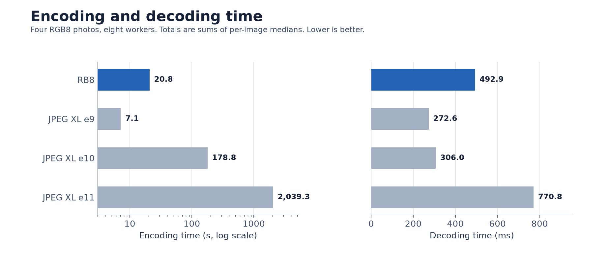
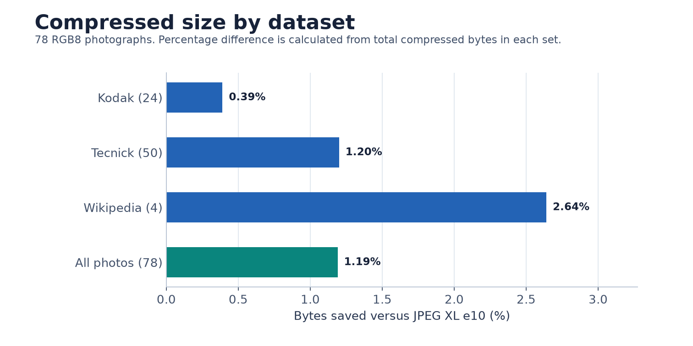
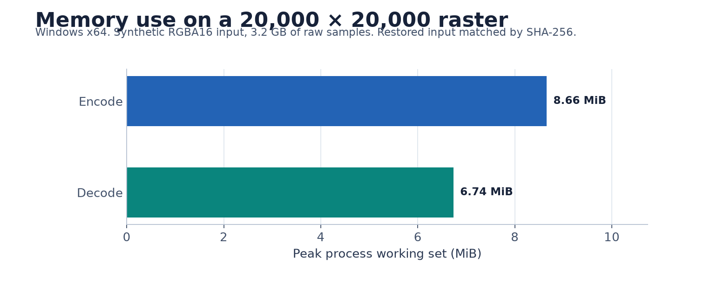

# RB8 lossless image codec

RB8 compresses static raster images and restores every decoded pixel sample. The photographic mode is tuned for RGB8. The streaming mode handles 8- and 16-bit grayscale, RGB and alpha rasters with bounded codec workspace. Archives can also carry supported EXIF, ICC and XMP metadata.

## [Evaluation binaries](https://github.com/Nerwe/rb8-showcase/releases/tag/v0.1.0)

| Platform | Download | Contents |
|---|---|---|
| Windows x64 | [Windows binary package](https://github.com/Nerwe/rb8-showcase/releases/download/v0.1.0/rb8-windows-x64.zip) | CLI, viewer, DLL and import library |
| Linux x64 | [Linux binary package](https://github.com/Nerwe/rb8-showcase/releases/download/v0.1.0/rb8-linux-x64.zip) | Shared library |

The binaries come from RB8 revision `0e67c69`. Each archive includes the applicable [RB8 terms](LICENSE) and third-party notices. [SHA-256 checksums](https://github.com/Nerwe/rb8-showcase/releases/download/v0.1.0/SHA256SUMS.txt)

After extracting the Windows package, run the following from PowerShell in the extraction directory.

```powershell
.\rb8.exe encode input.png image.rb8
.\rb8.exe decode image.rb8 output.png
.\rb8.exe view image.rb8
```

## Supported inputs

The Windows CLI accepts these static raster formats. File extensions are listed for convenience. The CLI detects the format from the file contents.

| Input format | Common extensions |
|---|---|
| PNG | `.png` |
| JPEG | `.jpg`, `.jpeg` |
| WebP | `.webp` |
| BMP | `.bmp` |
| Netpbm | `.pnm`, `.pbm`, `.pgm`, `.ppm`, `.pam` |
| QOI | `.qoi` |

Animated PNG and WebP are rejected. GIF, TIFF, HEIC, AVIF, SVG and camera RAW formats require conversion before import. The `decode` command produces PNG from an `.rb8` archive. RB8 preserves decoded pixel samples and supported metadata. Recovery of original JPEG file bytes is outside that scope.

### Bit depth and transparency

- **RGB8 photographs.** Use `--model --parallel` for the benchmarked photographic mode. This mode requires three 8-bit color channels.
- **16-bit images and alpha.** Use `encode` with no flags. For supported grayscale, grayscale with alpha, RGB and RGBA inputs, RB8 preserves the decoded 8- or 16-bit samples, including RGB values under fully transparent pixels. For 16-bit and alpha PNGs that support scanline streaming, RB8 selects the v10 stream automatically. Interlaced PNG and other supported formats may use an in-memory import path with a pixel limit.
- **Large rasters.** Use `--stream` to force v10 for a non-interlaced PNG, including RGB8. The raw streaming commands are also available for callers supplying their own interleaved pixel samples.

On four synthetic grayscale, 16-bit and alpha tests, JPEG XL produced smaller files than RB8 v10 at every tested effort (e7, e9, e10 and e11). Both codecs recovered every sample exactly. [Grayscale, 16-bit and alpha benchmarks](BENCHMARKS.md#grayscale-16-bit-and-alpha-formats)

## Benchmarks

On a four-photo RGB8 panel with eight workers, RB8 encoded the set in **20.765 s** versus **178.769 s** for lossless JPEG XL effort 10 and produced **2.03% fewer bytes**. JPEG XL e10 decoded faster on the same panel. The table covers JPEG XL efforts 1–11, plus grayscale, 16-bit, alpha and metadata tests. [Full comparison and methodology](BENCHMARKS.md)



On a separate corpus of 78 photographs, RB8 produced **1.19% fewer bytes** in aggregate than JPEG XL e10 and yielded smaller archives for **62 of 78** images.



The streaming test restored **3.2 GB** of synthetic RGBA16 samples byte for byte. Windows peak process working set was **8.66 MiB during encoding** and **6.74 MiB during decoding**.


